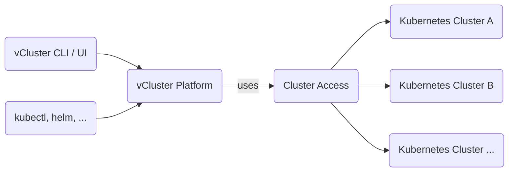

import NavStep from '@site/src/components/NavStep'
import Button from '@site/src/components/Button'
import Label from '@site/src/components/Label'
import Input from '@site/src/components/Input'
import Flow, { Step } from '@site/src/components/Flow'
import CreateSpaceStep1 from '@site/static/media/ui/screenshots/auth/login/login.png';
import CreateSpaceStep2 from '@site/static/media/ui/screenshots/spaces/create-space/button-open-drawer.png'
import PartialClusterAccessCreateUI from '../../../_partials/cluster/create-ui.mdx'

Cluster access allows you to give certain Users and Teams direct permission to a cluster without assigning them to a project. This is usually only useful for admin users or special privileged teams, while in all other cases you should prefer projects.


<br/>

Cluster access lets you define access to certain clusters for your users or teams along with the cluster roles that would be synced for them in the connected cluster. You can create your own Cluster Access by following the below steps.

### Create a cluster access

<Flow id="create-clusteraccess-ui">
  <Step>
    Go to <NavStep>Infra Management > Control Plane Clusters</NavStep>.
  </Step>
  <Step>
    Click the <NavStep>Cluster Access</NavStep> tab and then click <Button>Create Cluster Access</Button>.
  </Step>
  <Step>
    In the configuration sheet that opens, give the access a name by replacing the auto-generated placeholder name, or by updating the manifest YAML 'metadata.name' field.
  </Step>
  <Step>
    In the <Label>Options</Label> tab, choose the user or team to grant access from the <Label>Cluster Access</Label> selector, then choose the cluster role from the <Label>Cluster Roles</Label> selector.
  </Step>
  <Step>
    In the <Label>Clusters</Label> tab, choose the cluster to which the user or team should be granted access from the <Label>Select Clusters</Label> selector.
  </Step>
  <Step>
    In the <Label>Access</Label> tab, select the user or team that can manage this cluster access object, then choose their allowed permissions.
  </Step>
  <Step>
    Click <Button>Save Changes</Button> to create the cluster access.
  </Step>
</Flow>

## Cluster access and tenants

Direct access to a control plane cluster through Platform, such as `kubectl`
requests that Platform proxies to the cluster, needs a cluster access. It must
list the cluster and name the user, one of their teams, or all users.

A tenant user also needs their tenant's boundary to admit both the cluster and
the cluster access. A platform admin grants the cluster through the tenant's
`controlPlaneClusters` capability. For the cluster access, choose one of these options:

- **Assign it to the tenant** by setting `tenant.vcluster.com/exclusive-to` to
  the tenant name. Prefer this option. Only that tenant can read the cluster
  access.
- **Share it with every tenant** by setting `tenant.vcluster.com/all` to
  `"true"`. Every tenant can then read the whole object, including the users
  and teams it names. Use this only for a cluster access meant for every
  tenant, one that names all users rather than specific users or teams.

These labels go on the `ClusterAccess` object's `metadata.labels`. An unlabeled
platform-owned cluster access doesn't reach tenant users, even when it names them.
See [Ownership labels](../../manage-tenants/tenant-boundary-reference.mdx#ownership-labels).

Being able to see a cluster isn't enough. A tenant admin can read every cluster
granted to the tenant, but without a cluster access they can't reach into it.
Tenants can't create cluster accesses, so only a platform admin grants this.

A request that fails these checks is refused with `403` and this message.

```text
no cluster access: access denied
```

The agent proxy caches allowed access decisions for 15 seconds. It doesn't
cache denials, so a new grant doesn't have to wait for a denied decision to
expire. After access is revoked, requests with a cached allowance can continue
until that allowance expires.

:::warning A cluster access for all users reaches tenant users
A cluster access shared with every tenant that names all users grants access
to users in every tenant whose boundary admits the cluster. Assign the access
to one tenant or name specific users or teams to restrict its reach.
:::
